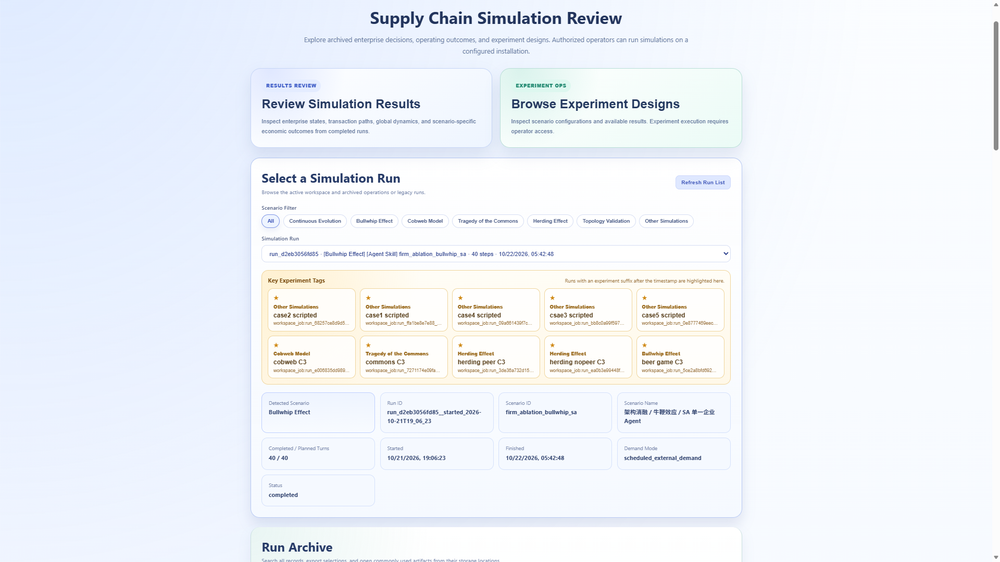
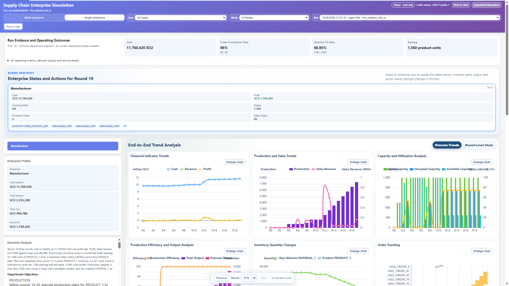
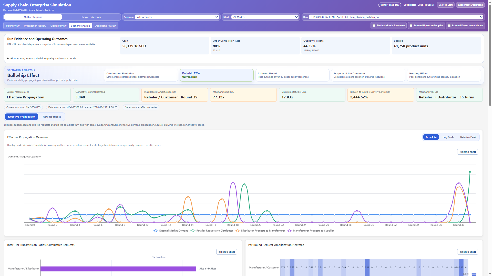
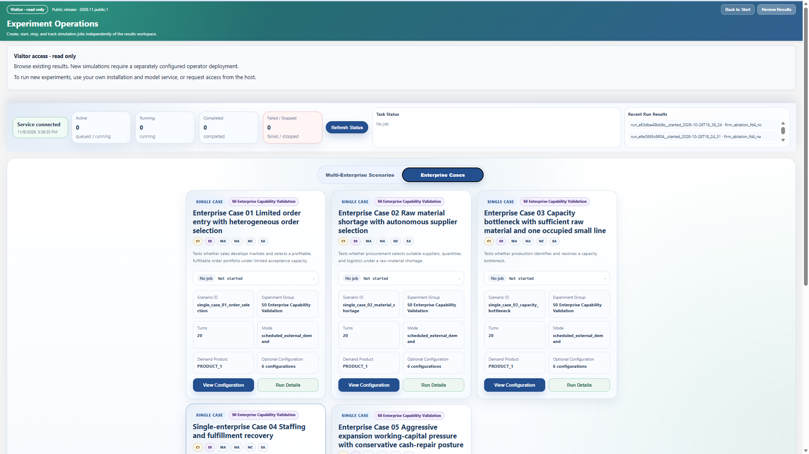

<div align="center">

# SupplyChainAgent

**Organizational enterprise agents in a configurable supply-chain economy**

Organizational Agent Skills &nbsp; | &nbsp; Executable Economy &nbsp; | &nbsp; Matched Experiments &nbsp; | &nbsp; Evidence Review

[Quick Start](#quick-start) · [Research Workflow](#research-workflow) · [Platform Tour](#experiment-interface) · [Scenarios](#scenarios) · [Documentation](#documentation)

</div>

SupplyChainAgent is a research platform for studying how LLM agents operate as enterprises and how their decisions produce supply-chain dynamics. Enterprise analysts and department Skills work with role-scoped observations and a private blackboard. A programmatic economic environment validates their proposed actions and advances inventory, cash, capacity, production, deliveries, and transaction commitments across simulation rounds.

The repository brings together the **enterprise agent architecture**, **economic execution engine**, **controlled experiment suite**, and **English results-review interface** developed for this research. Use Agent Skills for model-driven decisions or a scripted controller for deterministic reference runs. Visitors can explore published results without a model account; operators can configure independent experiments on their own installation.


*Architecture overview (Figure 1 in the manuscript). Enterprise analysts, role-specialized agents, and private blackboards interact with a programmatic supply-chain environment through structured actions, observations, and feedback. The topology shown is an example; firms, departments, information visibility, initial state, and economic mechanisms are configured per scenario. [Open the full-resolution PDF](docs/assets/architecture-overview.pdf).*

## What the Platform Provides

| Layer | Implemented capabilities | Research use |
| --- | --- | --- |
| Enterprise organization | Analyst, functional department Skills, authorized observations, private coordination, and a single-agent alternative | Compare diagnosis, coordination, and division of responsibility |
| Economic execution | Action validation, execution receipts, inventory, staffing, capacity, production, and finance | Connect proposed decisions to actual business-state changes |
| Inter-firm exchange | Requests, proposals, bilateral acceptances, confirmed orders, delivery, and settlement | Follow transaction lifecycles and operating dependencies |
| Experiment design | Five enterprise diagnosis cases, four economic mechanisms, topology presets, and long-horizon shocks | Study firm capabilities and system-level dynamics under configured conditions |
| Experiment management | Frozen job configurations, isolated workspaces, feedback-driven retries, serial batches, checkpoints, and source/Skill fingerprints | Execute and inspect comparison groups with separate run artifacts |
| Evidence review | Round-level states, decisions, messages, receipts, metric definitions, charts, comparisons, and downloads | Trace an observed outcome back to the records that produced it |

## Research Workflow

1. **Choose a question and a scenario.** Configure enterprise constraints, network structure, information visibility, controller conditions, or scheduled shocks through the scenario catalog.
2. **Run controlled comparisons.** Compare Agent and scripted controllers, or select Full/MA, NA, NC, and SA conditions for FD1–FD5. An automatic batch runs selected conditions in sequence, creating a fresh job, worker, configuration, and output directory for each item.
3. **Inspect execution as well as outcomes.** Follow diagnosis and department actions through execution feedback, then examine fulfillment, production, recruitment, liquidity, and inter-firm transactions. Task completion, valid model output, successful business execution, and economic performance are reported as distinct signals.
4. **Trace and export the evidence.** Review individual rounds, follow propagation across firms, compare archived runs, and download available records. Units, denominators, snapshot coverage, and source paths accompany the metrics.

The [architecture guide](docs/architecture.md) explains the round lifecycle. The [matched-experiment guide](docs/experiments.md) describes ablation conditions, frozen request manifests, batch behavior, and evaluation exports.

## Quick Start

The clean-install smoke test was verified with **Python 3.12.3**, **Node.js 18.19.1**, and **npm 9.2.0**. The startup script requires Bash. It defaults to a read-only visitor deployment. Operator mode enables new experiments; scripted runs need no model credentials, while Agent runs require your own model configuration.

### 1. Install Dependencies

Run from the repository root:

```bash
python3 -m venv .venv
.venv/bin/python -m pip install -r requirements.txt -c constraints-tested.txt
npm --prefix visualization ci
```

### 2. Start the Experiment Interface

```bash
bash scripts/start_integrated_app.sh
```

The script starts both services and checks backend readiness before launching the interface. Visitor mode serves a production build, rebuilding it only when the viewer source changes. For frontend development, set `SUPPLY_CHAIN_VIEWER_MODE=dev`. In visitor mode it skips `scripts/.env` and leaves experiment controls locked. See [visitor and operator deployments](docs/visitor_mode.md) for access setup.

| Service | Default address |
| --- | --- |
| Experiment interface | <http://127.0.0.1:3000> |
| Simulation and operations API | <http://127.0.0.1:8000> |
| Interactive API documentation | <http://127.0.0.1:8000/docs> |

Keep the terminal open while using the application. `Ctrl+C` stops the services. To select a different interpreter or avoid occupied ports:

```bash
PYTHON_BIN=.venv/bin/python BACKEND_PORT=8001 FRONTEND_PORT=3001 \
  bash scripts/start_integrated_app.sh
```

### 3. Browse Results or Enable Your Own Experiments

Before startup, or from a second terminal, import the [compact real FD4 example](examples/README.md) without model credentials:

```bash
.venv/bin/python scripts/import_result_example.py
```

Or publish an existing archive as a reviewed result copy:

```bash
.venv/bin/python scripts/publish_results.py /path/to/run
```

After importing or publishing, click **Refresh Run List** in the browser. Visitors read `agent/public_results/`; authenticated operators can also inspect
private job archives. Full historical archives are stored separately. See
[production deployment and result publication](docs/public_deployment.md).

To execute experiments on your own installation, configure your model service if needed and start an operator deployment:

```bash
export SUPPLY_CHAIN_PLATFORM_MODE=operator
export SUPPLY_CHAIN_OPERATOR_TOKEN="$(python3 -c 'import secrets; print(secrets.token_urlsafe(32))')"
bash scripts/start_integrated_app.sh
```

In **Experiment Operations**, enter the operator access token to unlock controls. Choose a scenario and configuration, then run it. The access token is distinct from a model API key and stays in browser memory only. Public deployments can display a host-configured application link; no browser action can enable a visitor server.

<details>
<summary><strong>Optional: run a two-round scripted smoke test through the API</strong></summary>

With an operator deployment running, export the same operator token in a second terminal and execute:

```bash
JOB_ID=$(curl -fsS -X POST http://127.0.0.1:8000/operations/jobs \
  -H "Authorization: Bearer $SUPPLY_CHAIN_OPERATOR_TOKEN" \
  -H 'Content-Type: application/json' \
  --data '{"scenario_id":"beer_game_scripted","planned_total_steps":2,"config_overrides":{"simulation":{"service_total_steps":2,"agent_run_steps":2}}}' \
  | python3 -c 'import json,sys; print(json.load(sys.stdin)["data"]["job_id"])')

curl -fsS -X POST "http://127.0.0.1:8000/operations/jobs/$JOB_ID/run" \
  -H "Authorization: Bearer $SUPPLY_CHAIN_OPERATOR_TOKEN" \
  -H 'Content-Type: application/json' --data '{}'

curl -fsS "http://127.0.0.1:8000/operations/jobs/$JOB_ID"
```

Job dispatch is asynchronous. Repeat the final request until the response reports `status: completed` and `completed_steps: 2`. This exercises job creation, multi-enterprise execution, checkpointing, and the operations database mirror.

</details>

## Scenarios

| Scenario family | Simulation focus |
| --- | --- |
| Supply-chain topologies | Firm relationships and transaction flow through configurable networks |
| [Beer game / bullwhip](docs/scenarios/bullwhip.md) | How local orders propagate into upstream demand variability |
| [Cobweb](docs/scenarios/cobweb.md) | Delayed supply decisions and market-price feedback |
| [Herding](docs/scenarios/herding.md) | How peer visibility changes firm decisions and collective behavior |
| [Commons](docs/scenarios/commons.md) | Resource extraction, renewal, and shared-resource pressure |
| Long-horizon evolution | Continued operation and responses to scheduled external changes |
| FD1: order selection | Market coverage and selection of profitable, fulfillable orders under limited acceptance capacity |
| FD2: material shortage | Supplier, quantity, and logistics choices for replenishment |
| FD3: capacity bottleneck | Production planning and capacity allocation |
| FD4: staffing shortage | Recruitment, production recovery, and order fulfillment |
| FD5: working-capital pressure | Expansion decisions, cash protection, and operating commitments |

Each economic guide explains the phenomenon, implemented mechanism, exact experiment conditions, metrics, and interface launch steps. The [configuration guide](docs/configuration.md) also covers FD1–FD5, topology presets, and the 200-round external-shock experiment.

The scenario registry is [config/simulation_preset_config.py](config/simulation_preset_config.py). Select a preset in the interface, or use `SIMULATION_SCENARIO_ID` for direct runs. The default preset is `architecture_linear_chain_short`.

Single-enterprise cases use fixed JSON setup actions to establish their starting conditions before Agent or scripted decisions begin. These setup actions are distinct from the scripted decision controller. See [configuration](docs/configuration.md) for the configuration structure.

Each FD case provides the following comparison conditions in its existing scenario card:

| Condition | Decision arrangement |
| --- | --- |
| Full / MA | Enterprise Analyst and functional department decisions with coordination |
| NA | Department decisions and coordination, with neutral context in place of model diagnosis |
| NC | Analyst and department decisions using authorized facts, without additional shared coordination or department messages |
| SA | A single enterprise LLM task performs diagnosis and produces all enabled functional decisions |

Bullwhip and peer-visible/hidden herding also provide SA conditions under their C3 operating regimes. See [matched experiments](docs/experiments.md) for exact configuration inheritance, retries, batch controls, and evaluation commands.

## Agent Setup

These steps apply to an explicitly enabled operator deployment. Visitor browsing does not load model configuration.

The Agent runtime uses the **Claude Agent SDK** and its Skill interface. Supply an endpoint and model supported by your SDK-compatible gateway.

```bash
cp scripts/.env.example scripts/.env
```

Edit the local `scripts/.env` file:

```dotenv
ANTHROPIC_BASE_URL=https://your-compatible-model-gateway.example
ANTHROPIC_MODEL=your-model-id
ANTHROPIC_AUTH_TOKEN=your-token
```

`ANTHROPIC_API_KEY` is also accepted for authentication. At operator startup, shell settings take precedence. Each new worker refreshes explicitly configured model settings from `scripts/.env`, so credential rotations take effect for new jobs. Keep credentials out of version control.

Check the SDK, bundled CLI, and resolved configuration before starting an Agent experiment:

```bash
bash scripts/check_agent_cli_env.sh
```

Restart the integrated application after changing model settings. The model gateway is a separate endpoint from the local simulation API.

Skills and structured action examples live in [agent/.claude/skills/](agent/.claude/skills/). See [firm agents and Skills](docs/agents.md) for the analyst, department roles, and runtime workflow.

## Experiment Interface

The English interface connects the experiment catalog to round-level evidence and scenario-specific analysis. Its compact toolbar keeps run, case, controller, and display choices together; layouts adapt to desktop, tablet, and narrow screens.

### 1. Find and Compare Archived Runs

[](docs/assets/results-browser.png)

Select a scenario family and run, inspect its configuration and completion status, then open its results. The archive supports filtering, selecting multiple runs, comparison summaries, record exports, and available public archive downloads.

### 2. Inspect Enterprise Decisions and Operating Outcomes

[](docs/assets/enterprise-round-review.png)

The screenshot shows an FD4 NC run. **Round View** combines enterprise state, executive analysis, department objectives, actions, feedback, and operating trends. Switch between process trends and round-level state; the fixed bottom round selector remains accessible while scrolling. Expand evidence details to inspect output quality, execution receipts, units, denominators, and source records.

### 3. Follow Inter-Firm and Economic Dynamics

[](docs/assets/bullwhip-analysis.png)

**Propagation Review** follows current-round order and production flows; **Global Review** summarizes system trajectories; **Operations Review** connects operating quantities and business records. **Scenario Analysis** provides dedicated views for bullwhip, cobweb, herding, commons, and long-horizon evolution. In the bullwhip view shown here, switch between effective propagation and raw requests, and use absolute, log-scale, or relative-peak displays to inspect different magnitudes.

Charts open in viewport-sized dialogs that adapt to window resizing, with an explicit **Close chart** button and Escape support. Empty flow views explain the absence of recorded flow. Loading indicators, local retry controls, and archive error messages keep the current state visible while data or view modules load.

### 4. Browse Designs and Manage Authorized Experiments

[](docs/assets/experiment-operations.png)

Visitors can inspect configurations and existing results. A separately enabled operator deployment unlocks launch, stop, recovery, and automatic-batch controls. Each batch item retains its own run environment and files, and the server scheduler continues after the browser closes.

**Efficient review:** production builds are reused until viewer source changes; compact chart projections, bounded concurrent reads, request cancellation, and caching reduce repeated archive work. View modules and detailed records load on demand. See [deployment and publication](docs/public_deployment.md) for preparing result copies and [interface and artifacts](docs/interface_and_artifacts.md) for the underlying files.

## Data and Databases

| Local location | Purpose |
| --- | --- |
| `agent/public_results/runs/` | Reviewed publication copies available to visitors |
| `agent/workspace_jobs/` | Generated jobs, configuration snapshots, firm artifacts, and checkpoints |
| `agent/runtime/` | Default operations database, logs, download caches, and runtime recovery records |
| `agent/workspace_jobs/_operations/` | Legacy operations database location retained when already present |
| `agent/workspace_multi/` | Active multi-enterprise working state |
| `agent/logs/` | Runtime and Agent SDK diagnostic logs |
| `agent/simulation_runs/` | Legacy local archives, when present |

These generated locations are ignored by Git. The release includes source, Skills, and executable setup templates; completed experiment data are distributed separately.

The [database/](database/) package retains **SQLAlchemy business models and repository access** for enterprise, product, and order records. This optional ORM database is separate from the SQLite operations mirror. Initialize its tables with:

```bash
.venv/bin/python -c 'from database.db_manager import init_db; init_db()'
```

The default ORM store is `local_orm.sqlite`. Set `DATABASE_URL` to use PostgreSQL. See [database storage](docs/database.md) for details.

## Project Map

| Directory | Responsibility |
| --- | --- |
| `agent/` | Enterprise runtimes, Agent Skills, scripted decisions, and setup templates |
| `config/` | Scenario registry, enterprise specifications, and runtime policies |
| `core/`, `enterprise/` | Economic state, action execution, and department business operations |
| `coordination/`, `message/` | Department communication and coordination protocols |
| `network/` | B2B exchange, proposals, orders, and firm relationships |
| `simulate/` | FastAPI simulation service and environment adapters |
| `runtime/`, `persistence/` | Job orchestration, archives, checkpoints, and storage projections |
| `database/` | Optional ORM models and repository access |
| `visualization/` | React/Vite experiment interface and analysis views |
| `scripts/`, `test/` | Startup tools, environment checks, and regression tests |

## Documentation

| Guide | Start here to understand |
| --- | --- |
| [Visitor and operator access](docs/visitor_mode.md) | Browse results or configure an authorized experiment host |
| [Public deployment and publication](docs/public_deployment.md) | Prepare reviewed result copies and host the production viewer |
| [Matched experiments](docs/experiments.md) | Understand MA/NA/NC/SA conditions, serial batches, and evaluation exports |
| [Compact example](examples/README.md) | Import the small real FD4 archive for an initial walkthrough |
| [Architecture and round lifecycle](docs/architecture.md) | How decisions, transactions, and persistent processes advance |
| [Scenarios and configuration](docs/configuration.md) | FD1–FD5, topology, long-horizon events, and configuration structure |
| [Bullwhip](docs/scenarios/bullwhip.md) · [Herding](docs/scenarios/herding.md) · [Cobweb](docs/scenarios/cobweb.md) · [Commons](docs/scenarios/commons.md) | Economic meaning, simulation design, metrics, and exact launch steps |
| [Firm agents and Skills](docs/agents.md) | How enterprise analysis and department decisions are organized |
| [Database storage](docs/database.md) | How operations storage and optional ORM storage differ |
| [Interface and artifacts](docs/interface_and_artifacts.md) | Where to inspect outcomes and find generated files |

## Development and Troubleshooting

```bash
# Run backend regression tests.
.venv/bin/python -m pytest test/

# Check and build the experiment interface.
npm --prefix visualization run lint
npm --prefix visualization test
npm --prefix visualization run build

# Install the browser once, then run visitor and failure-recovery checks.
(cd visualization && npx playwright install chromium)
PYTHON_BIN=.venv/bin/python npm --prefix visualization run test:browser
```

| Symptom | What to check |
| --- | --- |
| `vite: not found` | Run `npm --prefix visualization ci` from the repository root. |
| Missing Python backend dependencies | Install `requirements.txt`; point `PYTHON_BIN` to the project virtual environment. |
| No runs listed | Import the compact example or publish an existing archive; refresh the run list. |
| A chart has no flow | Check the selected round and external-flow filters; a round may have no recorded order or production flow. |
| A view fails after a release update | Use the visible retry or reload action to load the current frontend assets. |
| Data cannot be loaded | Check backend connectivity, the publication manifest, and the displayed archive availability message. |
| Agent gateway or authentication error | Run `scripts/check_agent_cli_env.sh` and verify the gateway, model, and credentials. |
| Port already in use | Choose available `BACKEND_PORT` and `FRONTEND_PORT` values. |

For a remote SSH session, keep the startup script running inside `tmux`. Forward the frontend port to access the interface locally:

```bash
ssh -L 3000:127.0.0.1:3000 user@server
```

Then open <http://127.0.0.1:3000> on your local machine. Use the selected frontend port if it differs from the default.

## License

Released under the [MIT License](LICENSE).
