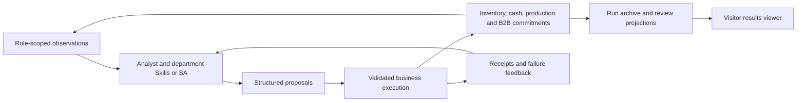

# Architecture and round lifecycle

[README](../README.md) · [Agents and Skills](agents.md) · [Configuration](configuration.md) · [Interface and artifacts](interface_and_artifacts.md)

## From enterprise decisions to economic state

SupplyChainAgent separates decision generation, business execution, and experiment management. Enterprise agents propose actions using their authorized observations. The economic environment validates those actions, changes authoritative state, advances persistent processes, and returns receipts. The experiment service manages workers and archives; the viewer reads recorded evidence independently of a live simulation.

| Layer | Main implementation | Responsibility |
| --- | --- | --- |
| Scenario construction | [config/](../config/) | Firms, products, topology, economic mechanisms, policies, and initial actions |
| Enterprise decision runtime | [agent/](../agent/) | Observations, role contexts, Skills, coordination, structured output, and feedback repair |
| Business environment | [core/](../core/), [enterprise/modules/](../enterprise/modules/) | Action validation, state changes, production, inventory, staffing, finance, and time |
| Inter-firm exchange | [network/](../network/) | Requests, proposals, bilateral acceptance, confirmed orders, delivery, and settlement |
| Simulation API | [simulate/](../simulate/) | Sessions, execution calls, observations, and environment advancement |
| Experiment management | [runtime/operations/](../runtime/operations/) | Frozen jobs, workers, stop/recovery, serial batches, and lifecycle status |
| Evidence and storage | [persistence/](../persistence/) | Filesystem artifacts, projections, operations mirrors, and review metrics |
| Results interface | [visualization/](../visualization/) | Archive selection, operating evidence, charts, comparisons, and downloads |

## Job lifecycle

1. The operator selects a scenario and condition. The operations service resolves defaults and permitted overrides into a job configuration.
2. A worker starts with a separate workspace, run identity, and configured decision runtime. The job records its configuration and execution provenance.
3. The simulation constructs firms, departments, products, markets, and exchange connections. Scenario initialization establishes their starting state.
4. The worker advances rounds, records completed state, and writes checkpoints and evidence.
5. Completion or failure produces a terminal job status and archive. Finished production sessions release their in-memory environment; the archive remains inspectable.

Set `SIMULATION_KEEP_FINISHED_SESSIONS=1` only when live post-run engine inspection is needed. Archived result inspection works independently of that setting.

A serial batch creates these resources separately for every item. It does not reset and reuse one archive. Source and configured model-route drift are checked before launching later items; drift pauses the batch for review.

## Round lifecycle

The precise enabled phases depend on the scenario and controller. The operating loop combines:

1. **Scheduled operations and observations.** Apply configured daily business processes and external market changes, then expose the relevant state to each role.
2. **Diagnosis.** The organizational controller generates enterprise analysis and department objectives. NA supplies neutral context; SA incorporates diagnosis into the unified decision.
3. **Department or unified decisions.** Generate structured actions using authorized facts, coordination context, and recorded history.
4. **Business submission and feedback.** Validate and execute eligible actions, return receipts, and use bounded failure-specific repair where enabled.
5. **Exchange and persistent processes.** Advance proposals, confirmations, production, recruitment, construction, deliveries, and settlement according to their timing rules.
6. **End-of-round evidence.** Record observations, action/results, exchange snapshots, projections, and complete-round state.

FD experiments have an explicit construction stage, R0–R9, followed by a decision stage, R10–R19. Scheduled setup actions construct the case; they are distinct from a scripted decision controller operating during the decision stage.

## Concurrent decisions and shared state

The current execution protocol is `ordered_business_commit.v1`. Model generation may run concurrently where configured. Business mutations are ordered by queue depth and then firm/department ID in the session workflow, and shared-state execution is serialized. Cash, stock, and capacity are validated against the state available when an action commits.

Mutation submissions carry a unique `submission_id` linked to a returned `receipt_id`. Repeating the same identity and body returns the stored receipt within the same live or restored checkpoint session; reusing the identity with a different body is rejected. Checkpoints retain these receipts. Recovery after an engine restart therefore restores the sealed session rather than replaying submissions into fresh state.

A rejected requested mutation returns failure feedback rather than its requested economic change. A multi-action decision can still contain earlier successful actions; its receipts identify which effects occurred. Repair must use those receipts rather than replaying the whole decision.

A transport timeout can leave an unknown business outcome. Such a session is quarantined instead of advancing or inventing a replacement result. The late receipt and sealed checkpoint determine the recovery path. This differs from an ordinary invalid model output, which can receive a bounded corrective attempt. The operator-only `GET /session/status` endpoint reports pending/quarantined work. The runtime `quarantine/` folder retains available late-result evidence.

## Transactions across rounds

Purchase intent, accepted proposal, confirmed order, completed delivery, and financial settlement are separate lifecycle events. A commitment can create later obligations after the originating round. A policy that limits new conversion spending does not automatically cancel an existing payable, delivery, or settlement obligation.

The exchange and department records let a reviewer follow a commitment through these events. An economic outcome should therefore be read from committed state and receipts, not from the model's statement of intent alone.

## Public viewing and private execution

A visitor deployment reads reviewed, manifest-backed publication copies. It does not load model settings from `scripts/.env` or start jobs. An operator deployment supplies its own model service and authorizes control with an independent access token.

Public results, private raw archives, writable runtime caches, and optional database stores have separate roles. See [access setup](visitor_mode.md), [publication](public_deployment.md), and [storage](database.md).
