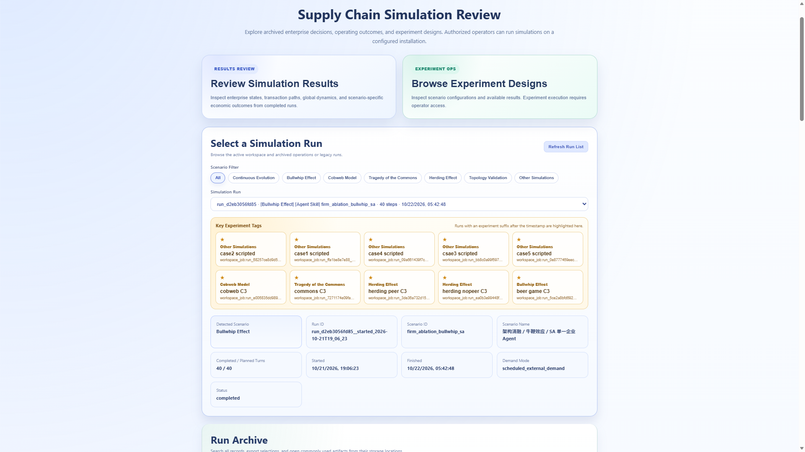

# Reviewing results and their evidence

[README tour](../README.md#experiment-interface) · [Scenario guides](configuration.md#scenario-guide-index) · [Publication](public_deployment.md)

## Open an archived run

1. Start the platform using `bash scripts/start_integrated_app.sh`. Visitor mode is the default.
2. Import the [compact FD4 example](../examples/README.md) or publish your archives if the installation has no public results.
3. On the start page, click **Refresh Run List**, filter by scenario family, and select a run. Check its ID, scenario, completion status, and configuration.
4. Choose **Review Simulation Results** / **Review Results**. The viewer opens the appropriate single- or multi-enterprise analysis.

The run selector reads `agent/public_results/` for visitors. Authenticated operators can also inspect private job archives. A new source checkout does not transfer this host's full historical dataset.

[](assets/results-browser.png)

## Navigation and display choices

The compact toolbar selects scope, case/scenario, controller mode, and run. Multi-enterprise results expose the pages supported by that archive. In Round View, the round selector stays fixed at the bottom while the user scrolls. Selecting another round refreshes the corresponding evidence; switching a single-enterprise round selects its round-level state view.

| Page | Use it to answer | Main evidence |
| --- | --- | --- |
| Round View | What did a firm observe, decide, execute, and achieve in this round? | Firm cards, diagnosis, objectives, action/results, finance, production, inventory, and exchange state |
| Propagation Review | How did demand and goods move between firms? | Current-round flow, flow trends, demand trace, and run summary |
| Global Review | What happened across the full network? | System financial/operating trends and cumulative network flows |
| Scenario Analysis | What happened to the selected economic mechanism? | Bullwhip, cobweb, herding, commons, or long-horizon charts |
| Operations Review | Which operating quantities explain the outcome? | Production, replenishment, inventory, delivery, and related trajectories |

Single-enterprise Round View offers **Process Trends** and **Round-Level State**. Its enterprise profile, executive analysis, actions, and operating charts describe the selected firm and available evidence.

**Finished-Goods Equivalent** converts compatible material quantities through configured recipes. **External Upstream Supplier** and **External Downstream Market** include those external boundaries in applicable plots. These display choices do not change the archived experiment.

At wide resolutions, display options share the navigation row; narrower layouts place them in **Display options**. Charts support **Enlarge chart**, **Close chart**, and Escape; enlarged renderers resize with the viewport. No recorded selected-round flow produces an explicit empty-state explanation.

## Evidence and metric semantics

The **Run Evidence and Operating Outcomes** panel shows headline values. Expand **All operating metrics, decision quality and source details** to inspect additional outcomes, execution quality, action lineage, units, availability, and source paths.

| Signal | Read it as |
| --- | --- |
| Job completed | The recorded planned execution reached its completion condition |
| Valid task output | A decision task produced output accepted by its protocol |
| Business receipt | The environment's accepted/rejected/executed outcome for a submission |
| Order completion | Completed orders relative to the recorded order denominator |
| Quantity fill | Fulfilled quantity relative to the recorded demand/cohort quantity |
| Recruitment batches / people | Separate counts of recruitment operations and onboarded headcount |
| Financial percentage | A value already in percent units, not an extra ×100 conversion |
| Repair evidence | Linked retry, replacement execution, or withdrawal, with recorded coverage |

Use the displayed enterprise, round/window, phase, denominator, and source when comparing values. Missing metrics remain unavailable rather than becoming zero. A cumulative snapshot and a decision-window delta measure different things.

## Compare and export

Return to the start page's **Run Archive**. Filter the records, select the runs of interest, and open their comparison summary. Where recorded, the comparison supports enterprise, post-warmup window, and phase selections.

Whole-run wall time and summed phase durations are displayed separately. Older archives can mix timezone-qualified start times with local finish times; the viewer labels the resulting timestamp basis. Retain that basis when exporting or comparing elapsed times.

Download the selected record JSON for metadata and links; use available archive downloads for the reviewed public files. The comparison/evidence exports include metric sources and units. Published archives omit private executable checkpoints and raw diagnostic material.

For a command-line export:

```bash
.venv/bin/python scripts/export_result_review.py /path/to/run \
  --enterprise Manufacturer
```

For FD paired evaluation, use the [dedicated ablation exporter](experiments.md#evaluate-and-export).

## Where the records live

All paths below are examples relative to a private run or its reviewed public copy. Presence depends on controller, archive version, and publication scope.

| Path | Contents |
| --- | --- |
| `run_meta.json` | Scenario and resolved configuration, provenance, timing, completion, and run identity |
| `enterprises/FIRM/records/dayN/` | Observation, analysis, and recorded decision evidence |
| `enterprises/FIRM/department/ROLE/dayN/` | Department state, action files, results, and execution audit |
| `enterprises/FIRM/firm_agent/dayN/` | Task/phase and attempt evidence for the unified execution protocol, when recorded |
| `public/exchange/dayN/` | Exchange snapshots, external demand, and mechanism metrics |
| `public/observer_state/dayN/end_of_day/` | Completed-round firm state |
| `public/observer_state/dayN/prewarm_end_of_day/` | FD construction-stage state where applicable |
| `projections/` | Compact review, trend, and evaluation products where generated |
| `public_manifest.json` | Published file membership and integrity hashes |

The [four scenario guides](configuration.md#scenario-guide-index) identify their mechanism-specific inputs. Public viewing reads backend artifact routes and manifest members, rather than arbitrary frontend filesystem paths.

## Loading and recovery

Loading indicators appear before the application, while switching views, and during archived-data reads. Navigation remains available around local view loading. Bounded reads, caching, cancellation of obsolete requests, compact projections, and on-demand detail sections reduce repeated archive work.

| Situation | Action |
| --- | --- |
| Empty run list | Import/publish records, then **Refresh Run List** |
| Catalog unavailable | Restore backend connectivity, then **Retry run list** |
| Archive unavailable | Inspect the displayed reason, then **Retry archive** or **Back to Start** |
| Local view failure | **Retry this view**, choose another view, or **Reload viewer** |
| Old frontend module after an update | **Reload viewer** to load the current release |
| Fatal rendering failure | Use the independent **Reload viewer** recovery screen |
| No flow in a selected round | Select another round or change the applicable external-flow display switches |

[Publication and deployment](public_deployment.md) explains how to prepare compact projections and deploy result files without changing their original archives.
